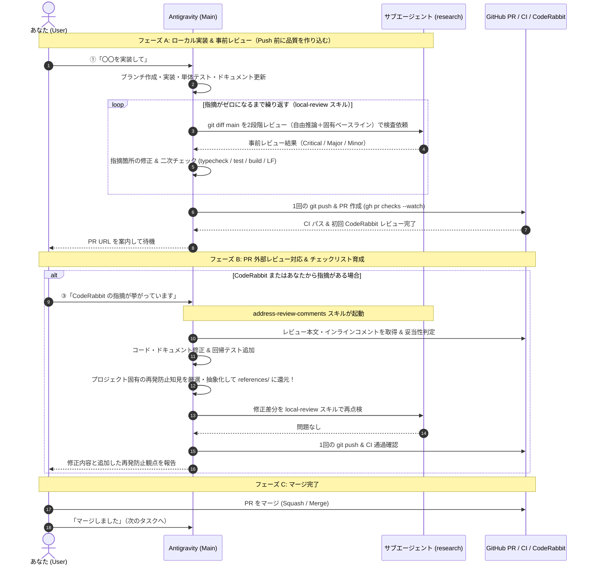
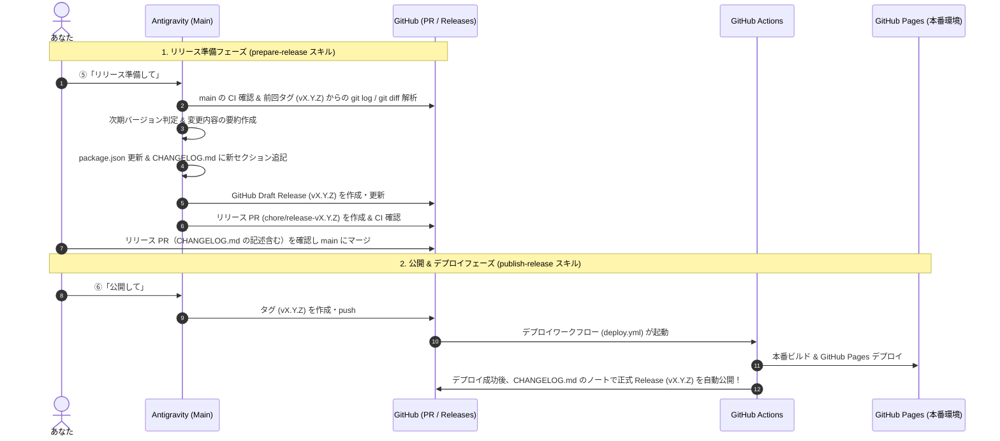

# 開発・ブランチ・リリース運用ガイド (Development & Release Flow)

## 1. 概要

本プロジェクトは **GitHub Flow** をベースに、AI コーディングエージェント（Antigravity）の **ローカル事前レビュースキル (`local-review`)**・**外部指摘対応スキル (`address-review-comments`)**、および **スキル主導の `CHANGELOG.md` 生成 + GitHub Releases 自動公開 (`prepare-release` / `publish-release`)** を組み合わせた開発・リリースパイプラインを採用しています。

---

## 2. あなたの指示チートシート（場面別フレーズ一覧）

日常の開発からリリースまで、あなたがチャットで伝える指示と、それによって自動起動するスキル・動作の早見表です。

| 場面 | あなたの指示（例） | エージェントの動き（使用スキル） | あなたの次のアクション |
| :--- | :--- | :--- | :--- |
| **① 新機能・修正を始める** | 「〇〇を実装して」<br>「〇〇を修正して PR を出して」 | トピックブランチ作成 → 実装・テスト・ドキュメント更新 → **`local-review` でローカル事前レビュー＆自己修正ループ** → 1回で Push & PR 作成 → CI 確認 | PR と CodeRabbit のレビュー結果を確認する |
| **② ローカル差分の点検だけしたい** | 「今の変更をレビューして」<br>「ローカルレビューして」 | **`local-review`（Read-Only）** でサブエージェントが 2 段階レビュー（自由推論 ＋ 固有ベースライン照合）を行い、指摘事項を報告（ファイルは変更しない） | 報告を見て修正するか判断する |
| **③ PR で指摘が出た** | 「CodeRabbit の指摘が挙がっています」<br>「PR のレビュー指摘に対応して」 | **`address-review-comments`** で指摘収集・判定 → 修正 → **プロジェクト固有の再発防止観点を `references/` に厳選還元** → **`local-review` で事前レビュー** → 1回で Push & CI 確認 | 指摘が解消されたら PR をマージする |
| **④ CodeRabbit 再実行後の監視** | 「CodeRabbit の再実行を行いました」<br>（PR 上で `@coderabbitai review` 投稿後） | `gh pr checks --watch` でレビュー完了を自動待機 → 指摘があればそのまま **③（`address-review-comments`）** を自動実行 | 完了報告を待ち、問題なければ PR をマージする |
| **⑤ リリース PR を作る** | 「リリース準備して」 | **`prepare-release`** で `main` の CI 確認 → 前回タグからのコミット・コード差分を解析して次期バージョン判定 & リリースノート要約 → `package.json` と `CHANGELOG.md` 更新・GitHub Draft Release 作成・リリース PR 作成 | リリース PR（`CHANGELOG.md` 含む）を確認してマージする |
| **⑥ 本番デプロイ・公開する** | 「公開して」<br>（リリース PR マージ後） | **`publish-release`** でタグ（`vX.Y.Z`）を Push → `deploy.yml` 監視 → GitHub Pages デプロイ & `CHANGELOG.md` の内容で Release 自動公開を確認 | 公開された本番ページ・Release を確認する |

> [!IMPORTANT]
> **人間のみが行う操作（エージェントによる自動実行禁止）**:
> - **PR の承認（Approve）およびマージ**
> - **PR 上での `@coderabbitai review` コメント投稿**（Free プランの使用制限・規約リスク回避のため）

---

## 3. 日常の開発・レビューサイクル（1 PR の流れ）

CodeRabbit のレート制限（1時間あたりのレビュー回数上限）を節約しつつ、レビューを受けるたびに内部チェックリスト（`.agents/skills/local-review/references/`）が賢くなるループ構造になっています。



### 関連スキル・ルール定義ファイル

| 種別 | パス | 役割 |
| :--- | :--- | :--- |
| **ルール** | [`.agents/rules/local-review.md`](../../.agents/rules/local-review.md) | 1〜8 の標準開発ループと厳守事項の定義 |
| **ルール** | [`.agents/rules/testing-integrity.md`](../../.agents/rules/testing-integrity.md) | 実装時における単体テストの完全性維持（既存テストの安易な改ざん・弱体化防止） |
| **スキル** | [`.agents/skills/local-review/SKILL.md`](../../.agents/skills/local-review/SKILL.md) | Push 前・依頼時の 2 段階ローカル事前レビュー手順（Stage 1: 自由推論 → Stage 2: 固有ベースライン） |
| **チェックリスト** | [`.agents/skills/local-review/references/`](../../.agents/skills/local-review/references/) | Stage 2 で照合するプロジェクト固有規約・既知トラップ集（TS/React、GitHub API/Security、Test/Docs） |
| **スキル** | [`.agents/skills/address-review-comments/SKILL.md`](../../.agents/skills/address-review-comments/SKILL.md) | PR 指摘の収集・トリアージ・修正・チェックリストへの厳選還元手順 |

---

## 4. ブランチ戦略 (GitHub Flow)

```text
[ feature/xxx ] ──(内部レビュー通過後に Push)──> [ PR 作成 ] ──(CI & レビュー通過)──> [ main へマージ ]
```

- **`main` ブランチ**:
  - 常に動作可能な最新の開発コードを保持します。
  - 直接 push / commit は禁止されています（GitHub のブランチ保護 + ローカル Git Hook による二重防止）。
  - 必ずトピックブランチから PR 経由でマージします。
- **トピックブランチ (`feature/*`, `fix/*`, `chore/*`)**:
  - 新機能や不具合修正ごとに作成します。
  - 命名例:
    - `feature/actions-usage-card`
    - `fix/token-validation-error`
    - `chore/update-dependencies`

> [!TIP]
> **ローカルでの誤コミット防止設定 (Git Hook)**:
> リポジトリ内の `.githooks/` を有効化するため、初回セットアップ時に以下を実行します。
>
> ```bash
> git config core.hooksPath .githooks
> ```
>
> これにより、`main` ブランチでの直接 `git commit` および `git push` が自動でブロックされます。

---

## 5. リリース運用フロー（2 つのステップ）

Web アプリケーション（GitHub Pages）の特性に合わせ、ストア審査や中間テスト（Pre-Release）を挟まず、また通常 PR ごとに Actions 分数を消費する外部ボット（Release Drafter）も使わずに、**「リリース準備時に AI スキルが前回タグからのコード差分・コミット履歴を解析して `CHANGELOG.md` と Draft Release を作成し、デプロイ成功時に正式公開する」** シンプルで高品質なフローを採用しています。



### ステップ 1: リリース準備 (`prepare-release` スキル)

- リリースを行いたいタイミングで、エージェントへ「リリース準備して」と依頼します。
- エージェントは前回リリースタグから `HEAD` までのコミット履歴（`git log`）およびコード差分（`git diff`）を解析し、Semantic Versioning に基づいて次期バージョンを提案・決定します。
- 変更点をカテゴリ（`### 🚀 新機能 / Features` / `### 🐛 バグ修正・改善 / Bug Fixes & Improvements` / `### 📖 ドキュメント・開発基盤 / Documentation & Developer Experience`）に整理・要約し、以下を一括実行します：
  1. `package.json` の `version` 更新
  2. [`CHANGELOG.md`](../../CHANGELOG.md) の先頭への新バージョンセクション追記
  3. GitHub Releases 上への Draft Release（`vX.Y.Z`）の作成（または更新）
  4. リリース PR（`chore/release-vX.Y.Z`）の作成（事前内部レビュー & CI 通過確認込み）
- あなたは PR 上で `CHANGELOG.md` のリリースノート文面を確認（必要に応じて修正指示）し、`main` へマージします。

### ステップ 2: リリース公開 & 自動デプロイ (`publish-release` スキル)

- リリース PR を `main` にマージ後、エージェントへ「公開して」と連絡します。
- タグ（例: `v1.7.0`）が作成・push され、`.github/workflows/deploy.yml` が起動します。
- プロダクションビルドおよび GitHub Pages へのデプロイが実行され、**デプロイが成功したタイミングで、`CHANGELOG.md` の該当バージョンセクションを本文として GitHub 上の Draft Release が正式な Release（Latest）として自動公開** されます。

---

## 6. GitHub Actions ワークフロー構成

| ファイル | トリガー | 役割 |
| :--- | :--- | :--- |
| **`.github/workflows/ci.yml`** | `pull_request`, `push` (main) | TypeScript 型検査 (`typecheck`)、単体テスト (`test`) & ビルド検証 (`build`) |
| **`.github/workflows/deploy.yml`** | `push` (tags: `v*.*.*`), 手動 | GitHub Pages デプロイ & 成功時の `CHANGELOG.md` 同期・Release 自動公開 |
